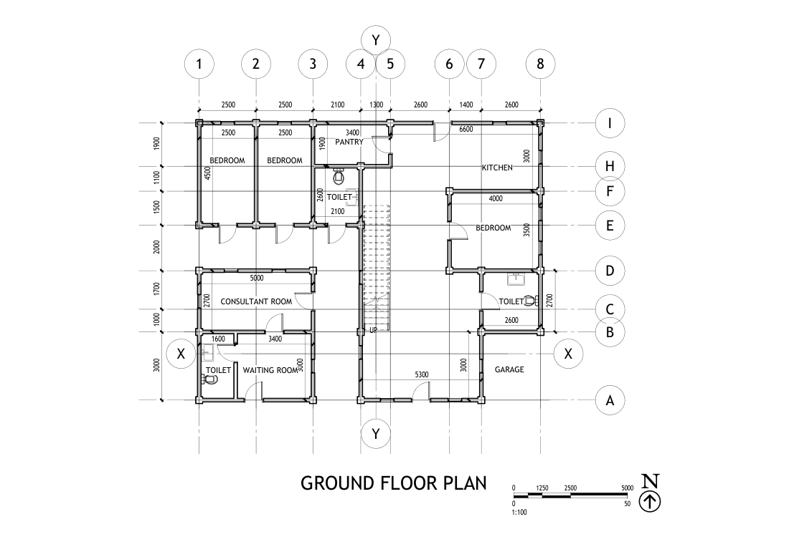
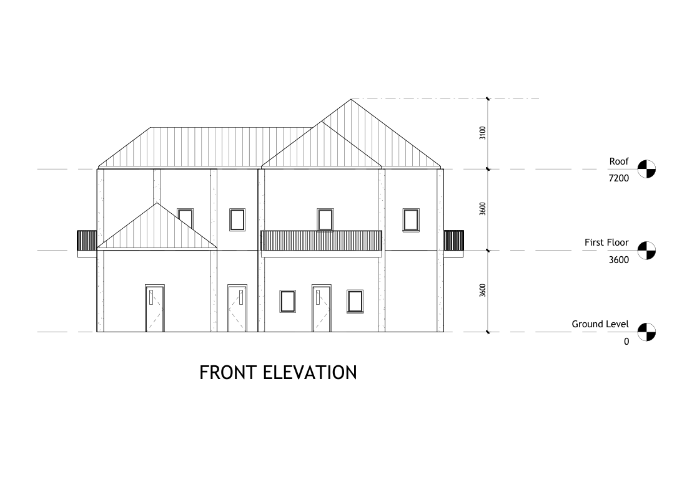
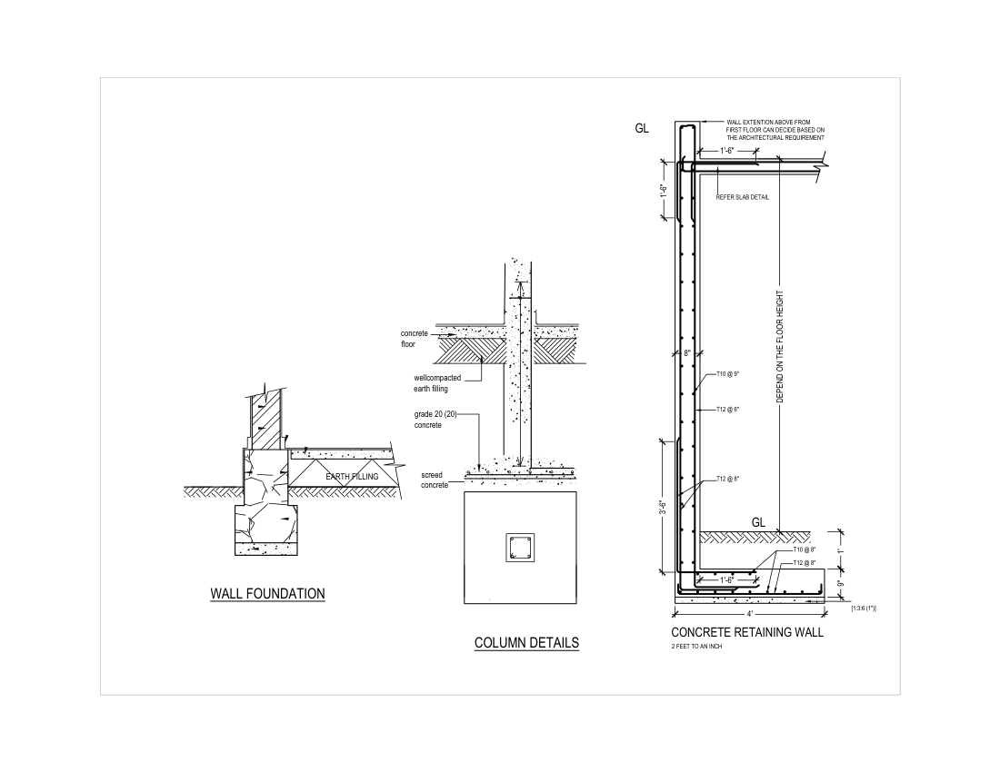

# Uni Project 1 (CE2130): Two-Storey Residence with Consultation Area

A complete planning drawing set for a two-storey building that combines a residence with a consultation area, produced for the University of Peradeniya module **CE2130**. Modelled in **Revit**, with sheets drafted and plotted from **AutoCAD**, and the model exported for rendering in **Lumion**.

**Status:** ✅ Complete drawing set.

## Building

| Item | Value (from the drawings) |
|---|---|
| Storeys | Ground floor + first floor; first floor at +3.6 m, roof at +7.2 m |
| Ground floor | Consultant room, waiting room, kitchen, pantry, three bedrooms, toilets, garage, staircase |
| First floor | Bedrooms, office room and toilets |
| Grid | Gridlines 1–8 and A–I, dimensions in mm, plans at 1:100 |
| Site | Site plan (1:1000) next to an 8 m wide road, with septic tank and soakage pit, waste-water pit and compost pit |

| Front elevation | Foundation and column details |
|---|---|
|  |  |

## Drawing list

| Drawing | PDF | CAD |
|---|---|---|
| Ground floor plan | [Ground.pdf](Ground.pdf) | `ground plan.dwg` / `.dwf` / `.dwfx` |
| Ground floor plan with slab reinforcement notes | [11.pdf](11.pdf) | `12345555.dwg`, `12345.dxf` |
| First floor plan | [First.pdf](First.pdf) | `first plan.dwg` |
| Front elevation | [front.pdf](front.pdf) | `Front Elevation.dwg` |
| Side elevation | [side.pdf](side.pdf) | `Side elevation.dwg` |
| Section X-X | [x-x.pdf](x-x.pdf) | `section 01.dwg` |
| Section Y-Y | [y-y.pdf](y-y.pdf) | `Section 02.dwg`, `Planning - Section - Section 3.dxf` |
| Roof arrangement | [Roof.pdf](Roof.pdf) | `Roof Arrangement.dwg` |
| Foundation and column details (wall foundation, column, retaining wall) | [FOUNDATION AND COLUMN.pdf](FOUNDATION%20AND%20COLUMN.pdf) | — |
| Septic tank (two compartments) | [SEPTIC TANK.pdf](SEPTIC%20TANK.pdf) | — |
| Door and window schedules | [door windows.pdf](door%20windows.pdf) · [door.pdf](door.pdf) | — |
| Site plans | [Plot.pdf](Plot.pdf) · [SIDE PLAN.pdf](SIDE%20PLAN.pdf) | — |
| Combined planning drawing | — | `Planning Drawing.dwg` |

## Models and exports

| File | Description |
|---|---|
| `Planning.rvt` | Revit building model |
| `Planning.dae` + `Planning_Textures/` | COLLADA export of the model with textures, for Lumion |
| `Lumion file.dae` + `Lumion file_Textures/` | Second Lumion export |
| `images/*.png` | PNG previews rendered from the PDF sheets |

## Skills shown

- Space planning for mixed residential and consultation use
- Coordinated plans, elevations and sections from one Revit model
- Foundation, column, retaining-wall and septic tank detailing
- Door and window schedules, site plan and services layout

## Opening the files

PDFs open directly on GitHub. Open `Planning.rvt` in Revit 2022 or later and the `.dwg` files in AutoCAD or the free Autodesk Viewer.
