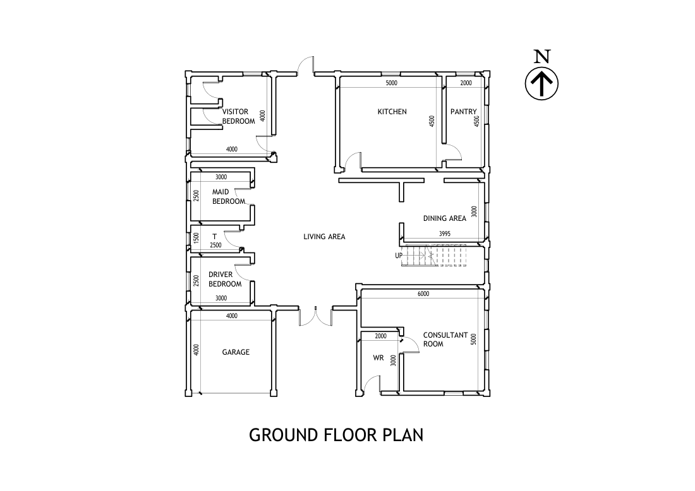
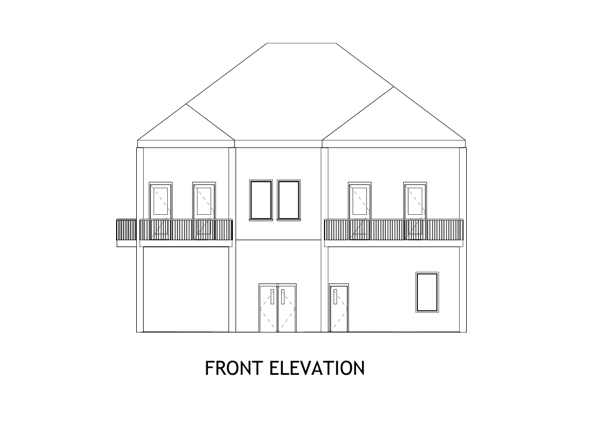

# Uni Project 2 (CE2130): Two-Storey House with Consultation Room

A two-storey residential design produced in **Revit** for the University of Peradeniya module **CE2130**, with a full set of plans, elevations, sections and a roof plan.

**Status:** ✅ Complete drawing set.

| Ground floor plan | Front elevation |
|---|---|
|  |  |

## Building

| Floor | Spaces (from the drawings) |
|---|---|
| Ground floor | Living and dining areas, kitchen, pantry, visitor bedroom, maid's and driver's bedrooms, consultation room, garage, staircase |
| First floor | Master bedroom, bedrooms 1–3, office room, living area, two balconies |

## Drawing list

| Drawing | File |
|---|---|
| Ground floor plan | [GROUND FLOOR.pdf](GROUND%20FLOOR.pdf) · [Project1.pdf](Project1.pdf) |
| First floor plan | [FIRST.pdf](FIRST.pdf) |
| Front elevation | [FRONT.pdf](FRONT.pdf) |
| Side elevation | [SIDE.pdf](SIDE.pdf) |
| Section X-X | [X-X.pdf](X-X.pdf) |
| Section Y-Y | [Y-Y.pdf](Y-Y.pdf) |
| Roof arrangement | [ROOF.pdf](ROOF.pdf) |
| Revit model | `Project1.rvt` |

PDFs open directly on GitHub. Open `Project1.rvt` in Revit 2022 or later.
