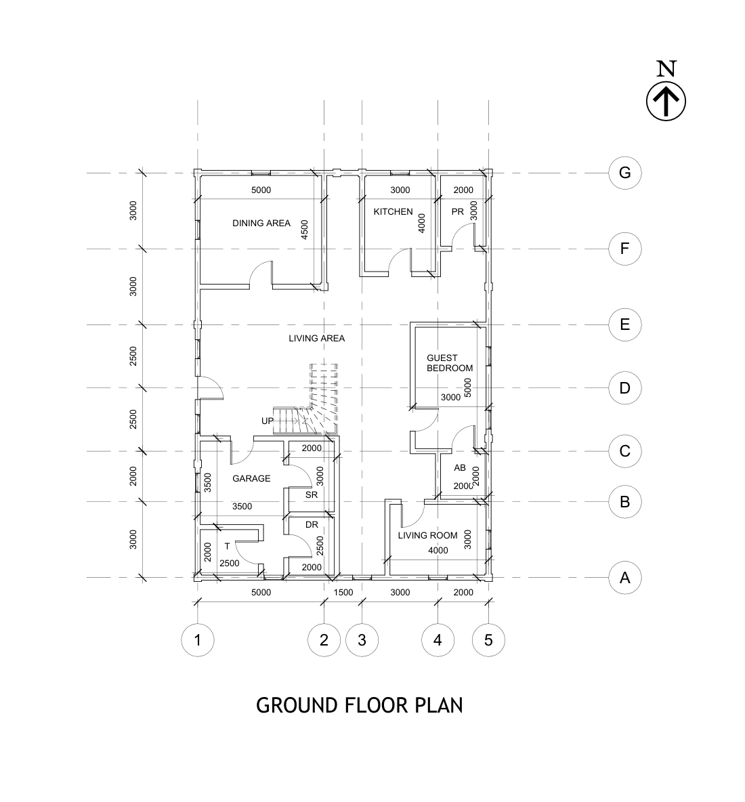
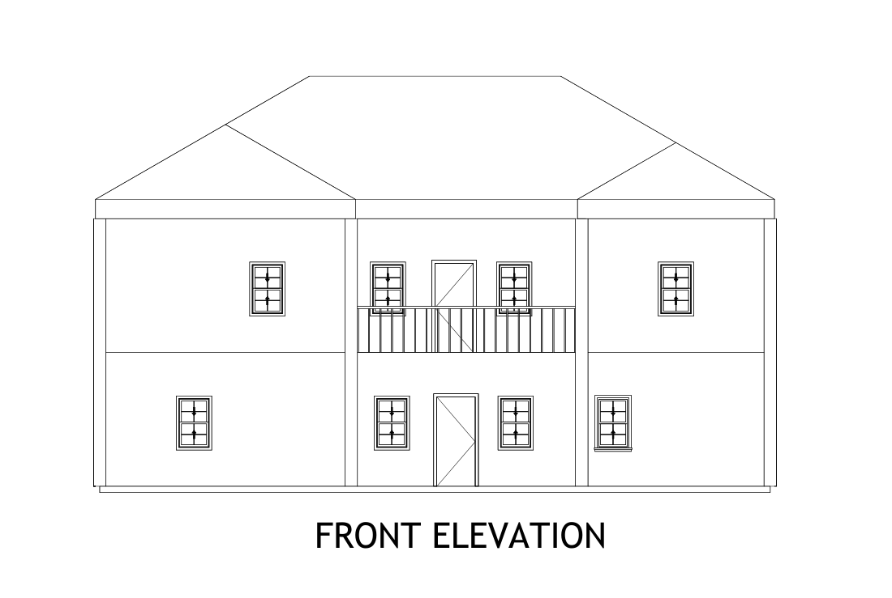

# Uni Project 3 (CE2130): Two-Storey House with Hipped Roof

A two-storey house designed in **Revit** for the University of Peradeniya module **CE2130**, with a hipped roof and a first-floor front balcony.

**Status:** ✅ Complete drawing set.

| Ground floor plan | Front elevation |
|---|---|
|  |  |

## Building

| Floor | Spaces (from the drawings) |
|---|---|
| Ground floor | Living room, kitchen, guest bedroom, garage, staircase |
| First floor | Master bedroom, bedrooms, common room, laundry, living area |
| Grid | Gridlines 1–5 and A–G, dimensions in mm |

## Drawing list

| Drawing | File |
|---|---|
| Ground floor plan | [GROUND.pdf](GROUND.pdf) |
| First floor plan | [FIRST.pdf](FIRST.pdf) |
| Front elevation | [FRONT.pdf](FRONT.pdf) |
| Side elevation | [SIDE.pdf](SIDE.pdf) |
| Section X-X | [XX.pdf](XX.pdf) |
| Section Y-Y | [YY.pdf](YY.pdf) |
| Roof arrangement | [ROOF.pdf](ROOF.pdf) |
| Revit model | `House Plan.rvt` |
| AutoCAD planning drawing | `Planning Drawing suan.dwg` |

PDFs open directly on GitHub. Open `House Plan.rvt` in Revit 2022 or later and the `.dwg` in AutoCAD or the free Autodesk Viewer.
