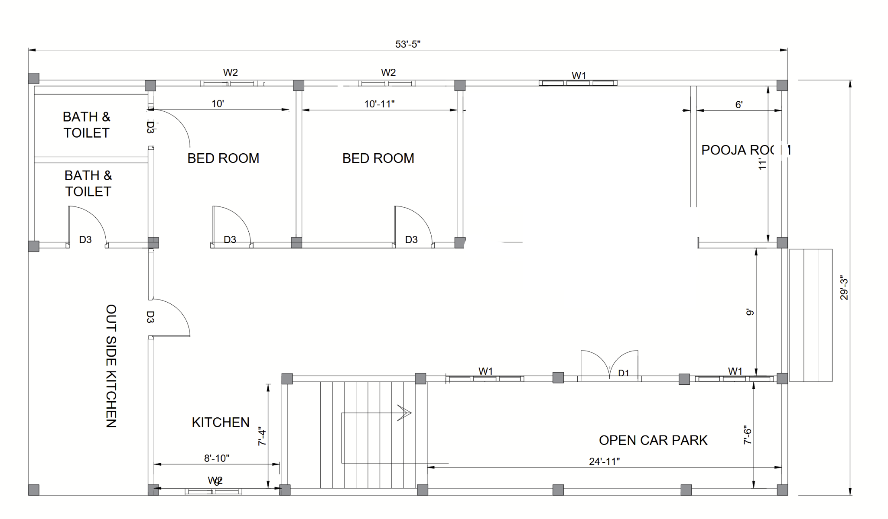
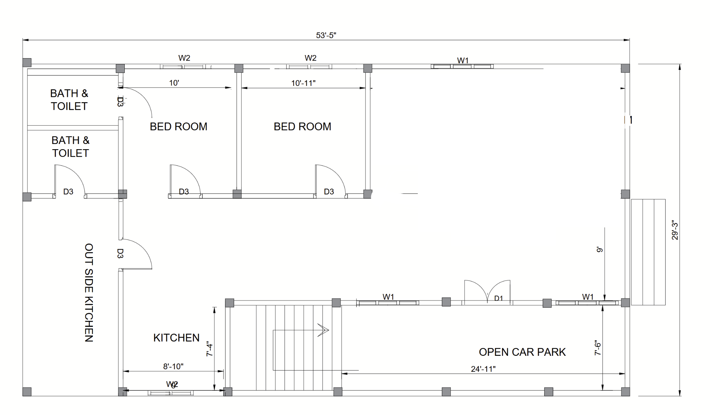

# revit 01: House Floor Plan Practice Model

A practice Revit model of a house ground floor plan, about 53'-5" × 29'-3" (16.3 m × 8.9 m), with two bedrooms, two bath and toilet rooms, a kitchen with an outside kitchen, a staircase and an open car park. Dimensions are in feet and inches.

**Status:** 🟡 Practice model.

| Plan with pooja room (`323.png`) | Plan variant (`Untitled-2.png`) |
|---|---|
|  |  |

The two images show two layout options; `323.png` adds a 6' × 11' pooja room.

## Files

| File | Description |
|---|---|
| `ASAS.rvt` | Revit model |
| `tm.tm` | Twinmotion scene file for visualisation |
| `323.png`, `Untitled-2.png` | Floor plan exports |

Open `ASAS.rvt` in Revit 2022 or later.
